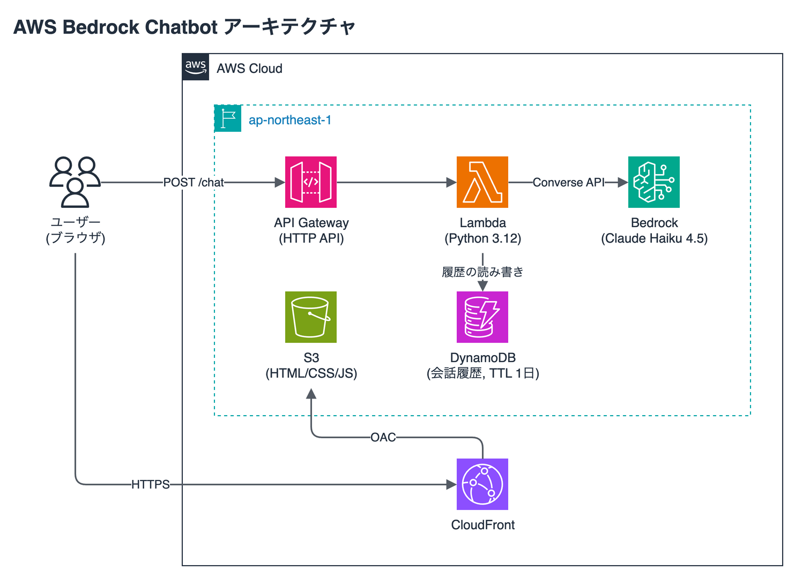

# AWS Bedrock Chatbot

Amazon Bedrock の Claude Haiku 4.5 と会話できる、サーバーレスのシンプルなチャットボット。

## 主な機能

- ブラウザのチャット画面から Claude Haiku 4.5（Bedrock Converse API）と会話する
- 会話履歴を DynamoDB に保存し、直近 10 往復を踏まえて応答する（履歴は TTL で 1 日後に自動削除）
- セッション ID をブラウザの localStorage に保持し、再訪時も同じ会話を続ける
- 認証なしで公開するため、API Gateway のスロットリング（10 req/s, burst 20）で料金の急増を抑える
- `cdk deploy` 1 回でインフラ・Lambda・フロントエンドをまとめてデプロイし、`cdk destroy` でデータごと片付く

## 技術スタック

| レイヤー | 技術 | バージョン |
|---|---|---|
| フロントエンド | HTML / CSS / Vanilla JavaScript（ビルド不要） | - |
| バックエンド | Python（AWS Lambda） | Python 3.12 |
| LLM | Amazon Bedrock（Converse API、JP クロスリージョン推論プロファイル） | Claude Haiku 4.5 |
| データベース | Amazon DynamoDB（オンデマンド課金 + TTL） | - |
| API | Amazon API Gateway（HTTP API） | - |
| ホスティング | Amazon S3 + CloudFront（OAC） | - |
| IaC | AWS CDK（Python） | aws-cdk-lib 2.170 以上 |
| 認証 | なし | - |

## アーキテクチャ構成図



## ディレクトリ構成

```
aws-chatbot/
├── frontend/               # 静的チャット UI（ビルド不要。config.js はデプロイ時に CDK が生成）
│   ├── index.html
│   ├── script.js           # チャットの送受信・セッション ID の管理
│   └── style.css
├── backend/
│   └── lambda/
│       └── app.py          # Bedrock Converse API の呼び出し + DynamoDB の履歴の読み書き
├── infra/                  # AWS CDK（Python）
│   ├── app.py              # CDK アプリのエントリポイント（リージョンの指定など）
│   ├── infra_stack.py      # DynamoDB / Lambda / API Gateway / S3 / CloudFront の定義
│   ├── cdk.json
│   └── requirements.txt
├── docs/images/            # README の画像（アーキテクチャ構成図）
└── LICENSE                 # MIT License
```

## 必要な環境

| ツール | バージョン |
|---|---|
| AWS アカウント + デプロイ権限を持つ IAM クレデンシャル | `aws configure` 済み |
| AWS CLI | v2 |
| Node.js | CDK CLI を `npx` で実行するため |
| Python | 3.12 |

## セットアップ手順

### 1. Bedrockのモデル利用準備（初回のみ）

AWS アカウントごとに 1 回だけ必要。

- 「Model access」ページでの事前有効化は不要（モデルは初回呼び出し時に自動で有効化される）
- ただし **Anthropic モデルは初回利用時に利用目的（use case）フォームの提出が必須**。未提出のまま呼び出すと `ResourceNotFoundException: Model use case details have not been submitted for this account.` になる
- AWS コンソール（リージョン: 東京）→ Amazon Bedrock →「Model catalog」→ **Claude Haiku 4.5** を開き、Playground などで一度呼び出そうとすると表示されるフォームを入力・送信する
- 反映まで最大 15 分ほどかかる

### 2. AWSインフラのデプロイ（AWS CDK）

以下は実際にローカル環境からデプロイした際に使用したコマンドです
（`<AWS_ACCOUNT_ID>` は自分のAWSアカウントIDに読み替えてください）。

```bash
# AWS CLI / Node.js / Python が使えるか確認
which aws node python3
aws --version

# AWS認証情報が有効か確認（アカウントIDやIAMユーザーが表示されればOK）
aws sts get-caller-identity
```

```jsonc
// 出力例（値はダミー）
{
  "UserId": "AIDAEXAMPLE1234567890",
  "Account": "<AWS_ACCOUNT_ID>",
  "Arn": "arn:aws:iam::<AWS_ACCOUNT_ID>:user/your-iam-user"
}
```

`aws configure` が未設定の場合は、先にIAMユーザー（またはSSO）のクレデンシャルを設定してください。

```bash
# Python仮想環境の作成とCDK依存パッケージのインストール
cd infra
python3 -m venv .venv
source .venv/bin/activate
pip install -r requirements.txt
```

CDK CLI（`cdk`コマンド）をグローバルインストールしていない場合は、`npx`経由でそのまま実行できます
（`npm install -g aws-cdk` 済みなら以下の `npx --yes aws-cdk@2` は単に `cdk` に読み替え可）。

```bash
# テンプレートが正しく合成できるか確認（AWSへの変更は発生しない）
npx --yes aws-cdk@2 synth

# 初回のみ：CDKが使うS3バケット等をアカウント・リージョンに作成
npx --yes aws-cdk@2 bootstrap aws://<AWS_ACCOUNT_ID>/ap-northeast-1

# 実際にデプロイ（承認プロンプトをスキップする場合は --require-approval never）
npx --yes aws-cdk@2 deploy --require-approval never
```

デプロイが完了すると、以下がターミナルに出力されます。

```text
Outputs:
AwsChatbotStack.ApiURL = https://xxxxxxxxxx.execute-api.ap-northeast-1.amazonaws.com/chat
AwsChatbotStack.SiteURL = https://xxxxxxxxxxxxxx.cloudfront.net
AwsChatbotStack.TableName = AwsChatbotStack-ChatHistoryTableXXXXXXXX-XXXXXXXXXXXX
```

- `SiteURL` — チャット画面のCloudFront URL（ブラウザでこれを開く）
- `ApiURL` — Lambdaを呼び出すAPIエンドポイント
- `TableName` — DynamoDBテーブル名

フロントエンドはS3+CloudFrontへの`BucketDeployment`でCDKが自動的にアップロードするため、
別途ビルド・デプロイコマンドを実行する必要はありません（`config.js`に`ApiURL`がデプロイ時に自動注入されます）。

### 3. 動作確認

`SiteURL`をブラウザで開くだけで動作します（静的サイトなのでローカルビルドは不要）。

フロントエンドを経由せず、APIエンドポイントを直接curlで叩いて疎通確認もできます。

```bash
curl -s -X POST "<ApiURLの値>" \
  -H "Content-Type: application/json" \
  -d '{"message": "こんにちは、自己紹介してください"}'
```

正常なら次のようなJSONが返ります。

```json
{"session_id": "xxxxxxxx-xxxx-xxxx-xxxx-xxxxxxxxxxxx", "reply": "こんにちは！..."}
```

同じ`session_id`を指定して再度送信すると、会話履歴（DynamoDB）を踏まえた応答になっているか確認できます。

```bash
curl -s -X POST "<ApiURLの値>" \
  -H "Content-Type: application/json" \
  -d '{"session_id": "<上で返ってきたsession_id>", "message": "さっき何て自己紹介した？"}'
```

## ライセンス

MIT License。詳細は [LICENSE](./LICENSE) を参照。
